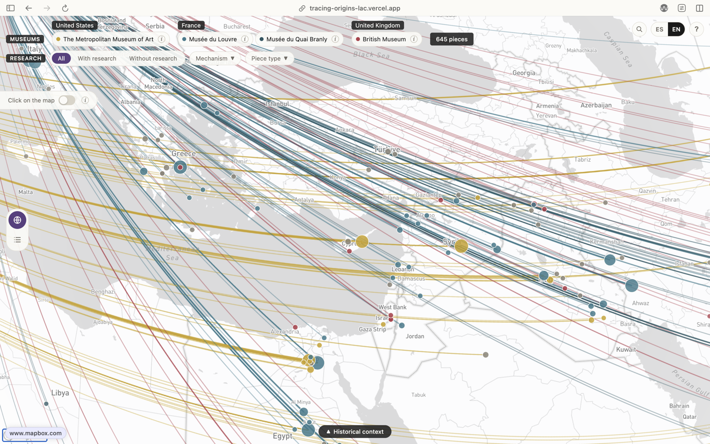
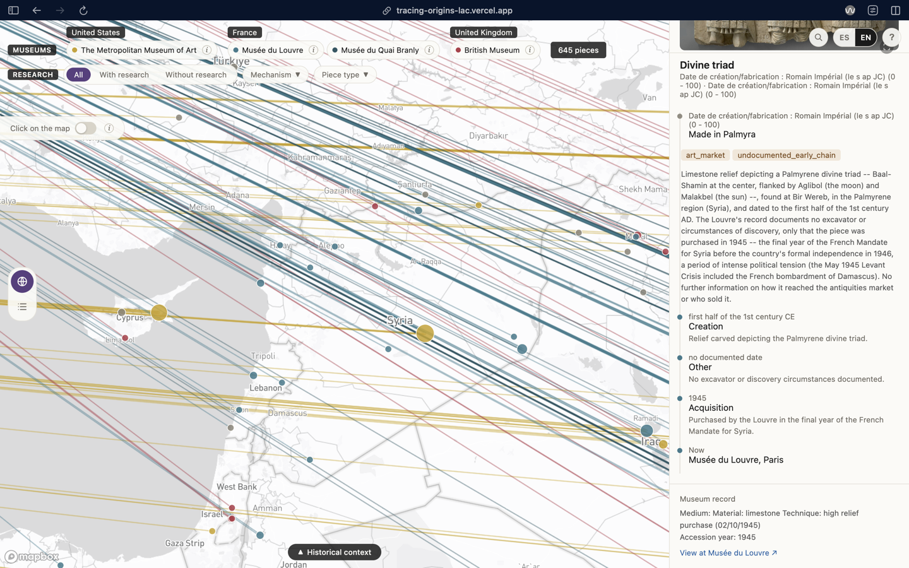
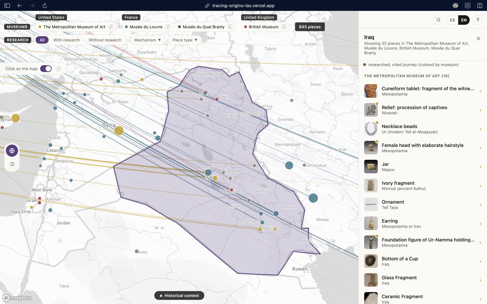
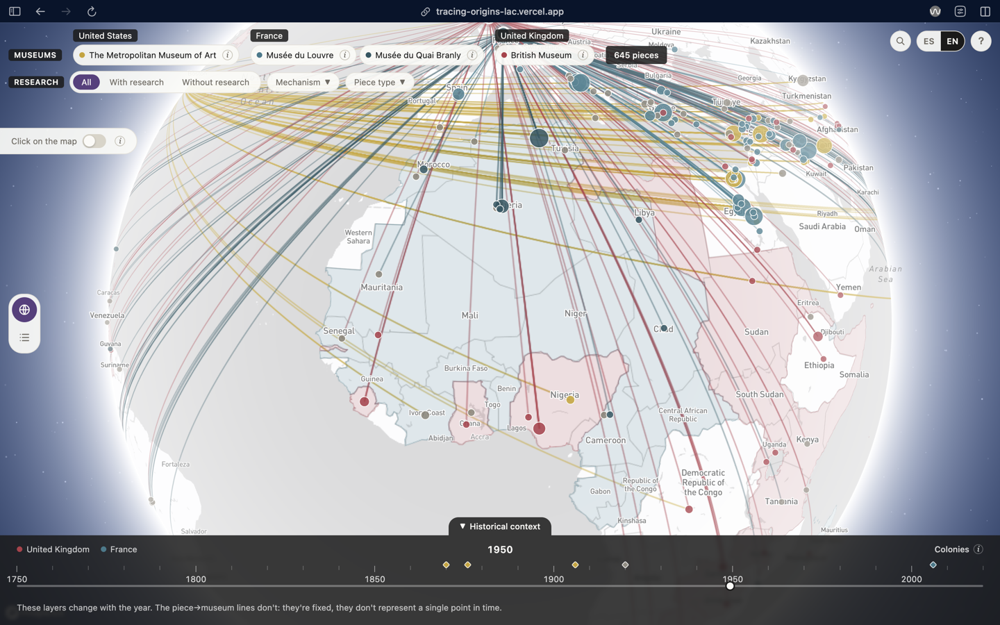
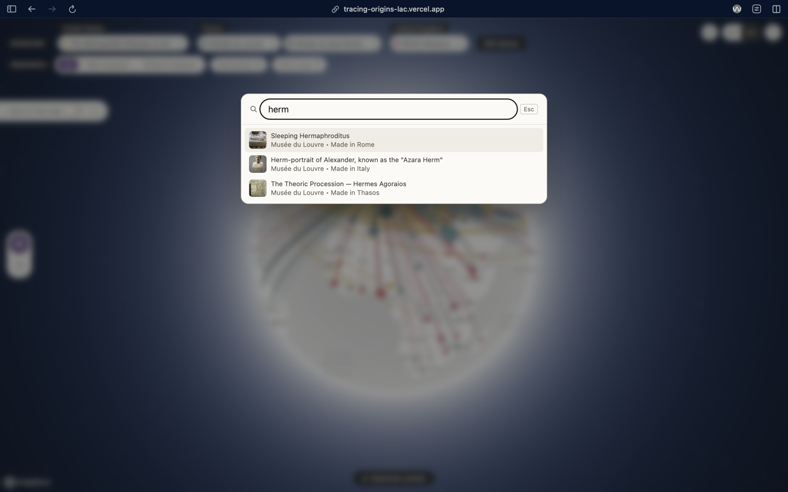
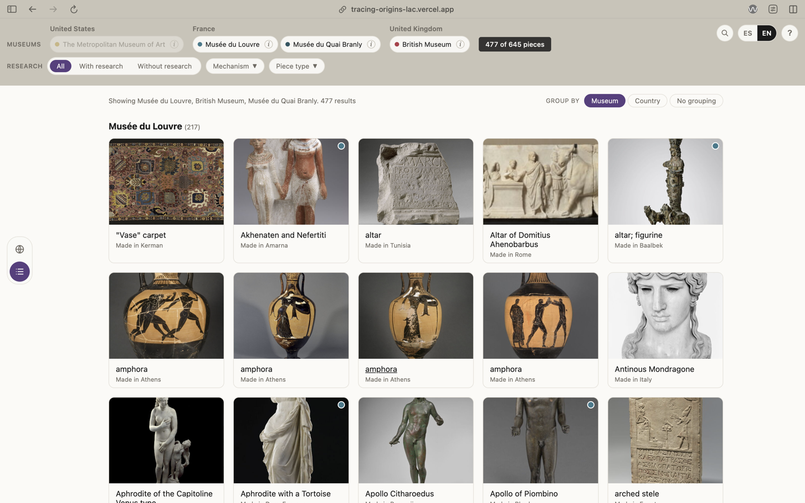
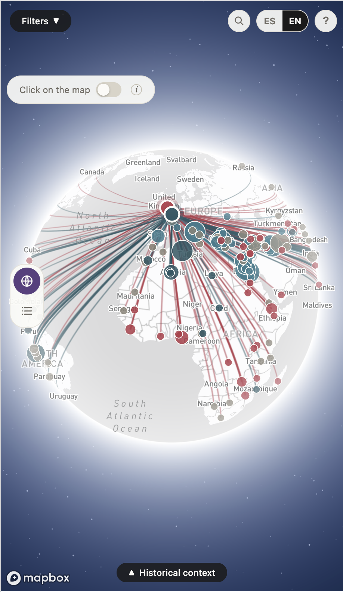

# Tracing Origins


**[Live demo →](https://tracing-origins-lac.vercel.app)**

Tracing Origins is an interactive map that follows museum objects back to where they came from. The goal is to make patterns of colonial-era acquisition easy to see, instead of leaving them buried in a catalog entry.

It covers four museums in former colonial powers: the **Metropolitan Museum of Art** (New York), the **Louvre** (Paris), the **British Museum** (London) and the **Musée du Quai Branly** (Paris). Quai Branly is there because the Louvre has no collection from Sub-Saharan Africa, the Americas, Asia or Oceania, and that is where most of Quai Branly's pieces come from.

This is a personal portfolio project. It's a curated sample of about 645 pieces, not a full catalog of any museum.

## Exploring the map

Every object has a line from its museum to its place of origin. Click an origin point to see every piece from there, and open a piece to read its record.



&nbsp;

Some pieces have a researched journey: creation, excavation, transfers and acquisition, each step with a source. There are 266 of them so far, from the Venus de Milo to the Rosetta Stone and the Benin Bronzes. The project never labels a piece as "stolen" or "not stolen". It documents the path and leaves the judgment to you.



&nbsp;

Turn on "Click on the map" and click any country to see its pieces grouped by museum, while the other lines fade out.



&nbsp;

Open "Historical context" to see the former British and French colonial territories change over time, from 1750 to 2020, and read the lines against who controlled what. The shading stops where our source's data stops: both countries still hold overseas territories today that aren't drawn here.



## Finding things

Press `/` (or Cmd/Ctrl+K) to open search. It shows the pieces you looked at recently, and filters by title as you type. You can also filter by museum, by how a piece was acquired and by type of object.



&nbsp;

If you'd rather not use the globe, `/list` shows the same pieces as a plain list, grouped by museum or country, with the same filters carried in the URL.



## Built to be usable by more people

The whole app works with a keyboard, and the list view is a full alternative to the map. Text meets contrast requirements, it adapts to small screens and 200% zoom, and it respects system settings for reduced motion, higher contrast and forced colors. The interface is in Spanish and English, including the researched text. I audited it with Lighthouse, axe and WAVE and tested keyboard use, zoom and color-blindness simulations by hand. A screen-reader pass with VoiceOver is still in progress.

<!--
 -->

## How the data is organized

Three layers, kept separate on purpose:

1. **What the museum says.** The raw record: title, material, culture, credit line.
2. **Where we think it's from.** A point of origin that we infer from each museum's text, so it's our guess and not their fact.
3. **What we've researched.** The cited journey of a piece, written by hand for a selected set.

The long version, with per-museum methods and a dated log of decisions, is in [`CLAUDE.md`](CLAUDE.md).

## Tech

- **Data pipeline:** Python. One fetcher and builder per museum, a hand-built geocoding table (no bulk geocoding calls) and a merge step that writes a single JSON file for the app.
- **App:** Vite, React, TypeScript and Mapbox GL (the 3D globe).
- **Sources:** museum APIs and public records. Colonial territories come from [Cliopatria](https://github.com/Seshat-Global-History-Databank/cliopatria) (CC-BY 4.0).

## Running it

```bash
pip install -r requirements.txt
cd web && npm install

# Data pipeline, from the repo root
python src/fetch_met.py --department 10
python src/fetch_louvre.py --per-department 60
python src/fetch_bm.py
python src/fetch_quaibranly.py --per-department 40

python src/build_dataset.py && python src/build_dataset_louvre.py && python src/build_dataset_bm.py && python src/build_dataset_quaibranly.py
python src/build_geography.py && python src/build_geography_louvre.py && python src/build_geography_bm.py && python src/build_geography_quaibranly.py
python src/export_web_data.py   # writes web/src/data/objects.json

# App
cd web
npm run dev      # local server
npm run build    # production build in web/dist
```

The app needs a `VITE_MAPBOX_TOKEN` in `web/.env`, and `objects.json` has to exist before `npm run dev` shows anything.

## Status

The core is done: four museums, the three data layers, the globe and list views, and the accessibility work. Research keeps growing as new well-documented pieces turn up, and next up are the VoiceOver pass and a decision on how to show colonial territories after 1999.

## Related

[heritage-vault](https://github.com/mente123/heritage-vault) maps African objects from the British Museum by country. Tracing Origins adds the route of each piece and the cited research behind it.
